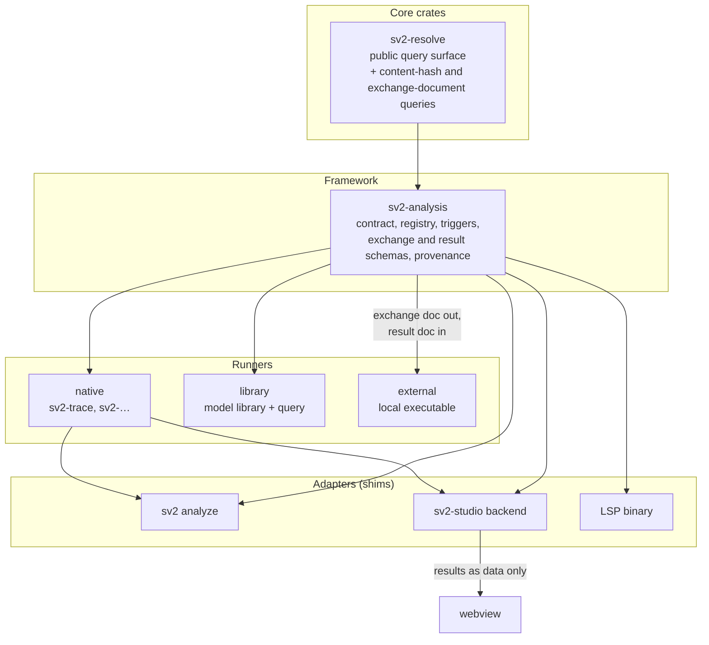

# Analyses are declared in the model, configured in sv2.toml, and run by in-tree runners

## Context and Problem Statement

[ADR-0019](0019-extensions-are-in-tree-consumers-of-the-resolved-model.md) fixed how
capabilities beyond parsing, resolution, and rendering reach the resolved model: as in-tree
extension crates over a protected query surface, contributing diagnostics and code actions
through a registry. Its worked example is requirements traceability, and its first concrete
check is the DOORS-style suspect link: a change to a requirement flags every trace
relationship touching it, and that flag propagates to parent and child requirements.

The intent for sv2-studio is wider than lint. It is meant to be the engineer's whole
digital-engineering workbench over a SysML v2 model: requirements checks, trace and
suspect-link propagation, verification status, parametric evaluation, simulation runs,
report and matrix generation, and whatever program-specific analysis comes next. A user
should be able to *configure* the tool to run a simulation against the model the same way
they configure it to run a lint, and see the outcome in the same place.

ADR-0019 does not fit that scope as written. It names a registry of "diagnostics and code
actions," which is the right shape for a lint and the wrong shape for a simulation that
yields a time series or a report that yields a document. It also constrains extensions to
Rust crates in this workspace, which rules out the common case of an analysis that already
exists as a Python script, a Modelica toolchain, or an OpenMDAO problem and should be
*invoked*, not rewritten.

The question is how to generalize the extension surface from "lint" to "analysis" without
giving up what ADR-0019 bought: a small core, no public plugin ABI, text as the only
authority, and no network.

## Decision Drivers

- **DD-1: One mechanism, not one per capability.** A lint rule, a trace check, a simulation,
  and a report generator differ in what they produce, not in how they are found, configured,
  triggered, and surfaced. Four mechanisms would be four sets of seams to keep stable.
- **DD-2: The language already models analysis.** SysML v2 has first-class analysis and
  verification case definitions and usages, calculation definitions, and user-defined
  metadata. An analysis the model already declares should not need to be declared a second
  time in a tool file.
- **DD-3: Existing analyses are not in Rust.** The simulations and scripts a program already
  trusts are external executables. Requiring a rewrite to integrate them is the same mistake
  ADR-0007 rejected for the resolver, in reverse.
- **DD-4: Everything ADR-0019 protected still holds.** Text is authoritative (ADR-0001), the
  resolver is library-neutral (ADR-0019 R-7), writes go only through text or an owned
  sidecar (R-4), and nothing compiles into the WASM adapter (R-8).
- **DD-5: No network, air-gapped, offline.** Invariant 6 and ADR-0020 R-1. An analysis may
  spawn a local process; it may not reach a service.
- **DD-6: Single-maintainer sustainment.** ADR-0019 DD-2 is unchanged. No public Rust ABI,
  no plugin marketplace, no versioned SDK.
- **DD-7: Results must be able to go stale, visibly.** A simulation result computed against
  last week's model is worse than no result. Staleness has to be derivable, not remembered.
- **DD-8: Interactive latency is a budget, not an assumption.** A suspect-link check runs
  on every edit; a simulation runs when asked. The framework has to tell them apart.

## Considered Options

1. **A general analysis framework with three runner classes.** One `Analysis` contract.
   Runners are native (in-tree Rust), library (model content plus a declarative query), or
   external (a local executable over a versioned exchange document). Declared in the model
   where the language provides a construct, configured in `sv2.toml`, surfaced through one
   typed result registry.
2. **Extend ADR-0019's registry only.** Keep diagnostics-and-code-actions as the sole
   result kind. Simulations become "diagnostics" whose message carries a path to an output
   file.
3. **Scriptable analyses in an embedded language.** Embed Rhai, Lua, or a WASM component
   runtime and let analyses be written against a scripting API over the query surface.
4. **Studio as an orchestrator of external tools only.** sv2 exports the model; every
   analysis, including lint, is an external program; sv2 renders what comes back.

## Decision Outcome

Chosen option: **Option 1, a general analysis framework with three runner classes.**

Option 1 keeps every ADR-0019 seam and generalizes the two that were too narrow: the
registry's result vocabulary and the "extensions are Rust crates" assumption. It meets
DD-2 by hanging analyses off the model's own constructs, DD-3 by admitting an external
runner, and DD-6 by keeping the external contract a data format rather than an ABI.

Option 2 was rejected under DD-1: forcing a time series through a diagnostic is a
conversion the UI then has to undo. Option 3 was rejected under DD-6 and ADR-0019 DD-8; a
scripting runtime is a second language surface with its own versioning story, and the
query surface it would expose is the same one R-3 says to grow deliberately. Option 4 was
rejected for the reason ADR-0019 rejected its Option 4: lint and trace need editing
latency, and an export boundary cannot deliver it. Option 4's export is kept, as the
external runner's exchange document.

### Definitions

| Term | Meaning |
|---|---|
| Analysis | Any computation over the resolved model beyond parse, resolve, and render, that produces results. Lint rules, trace checks, verification evaluation, simulations, reports, and exports are all analyses. |
| Runner | What executes an analysis. One of three classes: native, library, external. |
| Native runner | An in-tree Rust extension crate in the sense of ADR-0019. |
| Library runner | A model library plus a declarative query the framework evaluates. No new Rust code. |
| External runner | A local executable the framework spawns, fed an exchange document, returning a result document. |
| Exchange document | A schema-versioned, derived JSON document holding the resolved subset of the model an analysis declared as its input. |
| Result | One of the typed kinds in R-5: diagnostic, report, dataset, artifact. |
| Trigger | When an analysis runs: `on-edit`, `on-save`, `on-check`, `on-demand`, `ci`. |
| Provenance | The content hash of the inputs a result was computed from, carried on every persisted result. |

### Architecture



Dependency edges run from a native runner to `sv2-analysis` and `sv2-resolve` only, from
`sv2-analysis` to `sv2-resolve` only, and from an adapter to either. No core crate depends
on `sv2-analysis` or on a runner. The external runner is a process boundary, not a
dependency.

### Normative rules

| ID | Rule |
|---|---|
| R-1 | Every capability beyond parse, resolve, and render is an analysis implementing one contract, owned by a new crate `sv2-analysis`: an identifier, a diagnostic prefix, declared input selection, declared result kinds, supported triggers, and a latency class (`interactive` or `batch`). There is no separate lint, trace, simulation, or report mechanism. |
| R-2 | A runner is exactly one of three classes. **Native**: an in-tree crate bound by ADR-0019 R-1 through R-9 unchanged. **Library**: a model library and a declarative query the framework evaluates; it ships no Rust code. **External**: a local executable the framework spawns. No fourth class exists, and in particular no in-process scripting runtime and no dynamically loaded native code. |
| R-3 | Where SysML v2 provides a construct for the thing being analyzed, the analysis is declared in the model with that construct and bound to a runner by metadata: analysis case definitions and usages for analyses, verification case definitions and usages for verification, calculation definitions for parametrics. The binding metadata is a library the framework ships, `vendor/`-pinned like the standard library, and each use of a language construct in the framework carries its clause citation (Invariant 4). The model says *what* is analyzed and against *which* subject; `sv2.toml` says *whether* and *when*; the runner says *how*. |
| R-4 | `sv2.toml` gains an `[analysis]` table that absorbs ADR-0020's `[lint]`. Each entry is keyed by analysis identifier and holds: `level` (`allow`, `warn`, `deny`), `trigger`, runner options, and, for external runners, the executable contract (R-11). `[lint]` remains valid as an alias for `[analysis.lint]`. ADR-0020 R-10 is unchanged: specification constraints and ADR-0021 fixed diagnostics are not analyses and cannot be configured away. |
| R-5 | Results are typed, and the registry is a registry of results, not of diagnostics. Four kinds: **diagnostic** (the existing `Diagnostic`, with a range, for the gutter and CI), **report** (a rendered document for a panel or a file), **dataset** (tabular or time-series data with a declared schema, for a chart or a table), **artifact** (an opaque file the runner produced). Adding a result kind is an edit to `sv2-analysis` and to each adapter's renderer; adding an analysis is an edit to neither. |
| R-6 | Persisted results are derived sidecars, headed per ADR-0019 R-6 with `schema`, owning analysis, and class `derived`. A result that cannot be regenerated, such as a suspect-link acceptance baseline or an accepted simulation outcome, is an authored sidecar owned by the analysis. Nothing writes model text except through the ADR-0001 round trip. An external runner's stdout, stderr, and working directory are not a write path; only the result document the framework ingests is. |
| R-7 | Every persisted result carries provenance: the content hash of its declared inputs, computed by a core query (ADR-0019 R-3), and the identifier and version of the runner. A result whose provenance no longer matches the model is **stale**, and the framework surfaces staleness as a diagnostic in the analysis's own prefix without re-running anything. Suspect-link propagation is this rule applied to trace relationships: a trace result is stale when either end's hash moved, and staleness propagates along the relationships the analysis declares. |
| R-8 | Analyses run where the resolver runs: the studio backend, the LSP binary, and the CLI (ADR-0019 R-8). The webview receives results as data and never runs an analysis. `interactive` analyses may be bound to `on-edit` and `on-save`; `batch` analyses may be bound only to `on-check`, `on-demand`, and `ci`. The framework rejects a configuration that binds a batch analysis to an interactive trigger. |
| R-9 | Batch analyses run asynchronously with progress, cancellation, and a per-run log the adapters can show. A run that is cancelled or fails leaves prior results in place, marked stale if their provenance moved, and never leaves a partially written sidecar. |
| R-10 | Every analysis is listed in the extension manifest (ADR-0019 R-9) with its runner class, prefix, result kinds, latency class, declared sidecars, and, for external runners, the executable contract. The manifest is the only place a runner is named; the framework discovers nothing by scanning. |
| R-11 | An external runner's executable is named in `sv2.toml` by a path that is relative to the declaring file and inside the repository (ADR-0020 R-13), or by a bare name that must appear in an explicit `[analysis.allowed-executables]` list. The framework spawns it with a declared working directory under the repository, an explicitly passed environment, the exchange document on stdin or at a declared path, and a timeout. It inherits no environment, no credentials, and no network policy beyond the host's. This is isolation by convention, not a sandbox, and the manifest entry says so. |
| R-12 | The exchange document is produced by a core query over the resolved model, scoped to the analysis's declared input selection, schema-versioned, and derived. It is never committed as model content and never read back as one. Its schema and the result document's schema are owned by `sv2-analysis` and versioned with it. An external runner that targets an older schema version is reported, not silently accepted. |
| R-13 | The CLI surface is `sv2 analyze` with `list`, `run [--trigger <t>] [<id>…]`, `status` (provenance and staleness, no execution), and `accept <id> <result>` for analyses that own an authored baseline. Exit statuses follow `sv2-cli`'s `ErrorCode` taxonomy (STD-002-RS §3.2); analysis results never change the process exit code except through `deny`-level diagnostics. |
| R-14 | The studio surfaces every result kind through one results model: diagnostics in the editor gutter and problems panel, reports in a document panel, datasets in a table or chart panel, artifacts as links, and staleness as a badge on the element and on any diagram node projecting it. Diagram overlays for results are derived decorations and are not part of the ADR-0017 style cascade. |

R-3 is the rule with the most leverage, as ADR-0019 R-7 was. It makes a program-specific
simulation a model element plus a configuration line rather than a tool change, and it
means the same model file declares the analysis to every tool that reads it, not only to
sv2.

R-7 is what turns "suspect links" from a feature into a property of every result. The
mechanism that flags a trace relationship when a requirement changes is the same one that
flags a simulation result when its inputs change.

### Consequences

- Good, because a suspect-link check, a parametric evaluation, and an external simulation
  are configured, triggered, run, and displayed the same way (DD-1).
- Good, because existing Python or toolchain analyses integrate by reading one JSON
  document and writing another, with no Rust and no ABI (DD-3, DD-6).
- Good, because an analysis declared as a SysML v2 analysis case is model content:
  versioned with the model, reviewable in a diff, readable by other tools (DD-2).
- Good, because staleness is derived from provenance and never has to be remembered or
  manually cleared, except where an authored baseline deliberately records acceptance
  (DD-7).
- Good, because ADR-0019's seams survive intact; this record adds a framework crate beside
  them and widens two definitions.
- Bad, because `sv2-analysis` is a new crate on the critical path before `sv2-resolve` has
  a query surface, and its contract will be shaped by its first native runner
  (RISK-0026-1).
- Bad, because the exchange and result schemas are a versioned public surface, which is the
  obligation ADR-0019 DD-2 wanted to avoid. It is accepted because a data schema is cheaper
  to keep stable than an ABI, and because without it DD-3 cannot be met.
- Bad, because the external runner is not sandboxed. A configured executable can do
  anything the user can. R-11 limits what the framework hands it, not what it does.
- Bad, because four result kinds means four renderers in every adapter, and a fifth kind
  touches all of them.
- Neutral, because `[lint]` becomes an alias; existing ADR-0020 examples keep working and
  are migrated when touched.

### Confirmation

| ID | Fitness function | Method |
|---|---|---|
| FIT-1 | One contract (R-1, R-2) | `scripts/check_rust_workspace.py` reads the manifest and fails on any runner crate that does not depend on `sv2-analysis`, on any runner class outside the three, and on any crate not in the manifest that depends on `sv2-analysis`. |
| FIT-2 | Dependency direction (R-1, ADR-0019 R-1) | `cargo deny check bans` over `deny.toml`: no core crate depends on `sv2-analysis` or a runner; no runner depends on a core crate below `sv2-resolve`. |
| FIT-3 | Results are typed and registered (R-5, R-10) | A registry test asserts every analysis identifier and diagnostic prefix is unique, every declared result kind is one of the four, and every analysis in the manifest registers at startup. |
| FIT-4 | Staleness is derived (R-7) | A test mutates a declared input, re-opens without re-running, and asserts the result is reported stale; a mutation outside the declared inputs leaves it fresh. |
| FIT-5 | Interactive triggers are bounded (R-8) | A negative configuration test binds a `batch` analysis to `on-edit` and asserts a configuration diagnostic; a counter test (ADR-0024 style) ratchets the `interactive` set's cost per edit. |
| FIT-6 | External runner contract (R-11, R-12) | Negative cases: an absolute path, a path outside the repository, a bare name not in the allowlist, an inherited environment variable observed by a probe runner, a result document with an unsupported schema version. Each produces a diagnostic and no run. |
| FIT-7 | No partial sidecars (R-9) | A runner that fails mid-write leaves the prior sidecar byte-identical. |
| FIT-8 | Model declarations are cited (R-3, Invariant 4) | `scripts/check_rust_patterns.py` flags any qualified-name string in `sv2-analysis` matching a library element without an adjacent clause citation, under the ADR-0019 FIT-4 allowlist rule. |
| FIT-9 | The framework is sufficient in practice | The first three runners, one of each class (`sv2-trace` native, a criticality-attribute lint as library, a Python simulation as external), ship with no change to `sv2-analysis` other than added result renderers and no change to `sv2-resolve` other than added queries. Anything else is a finding against this record. |

## Pros and Cons of the Options

### Option 1: General analysis framework with three runner classes

- Good, because it generalizes ADR-0019 rather than replacing it.
- Good, because the external class admits the analyses that already exist.
- Good, because the library class means many program-specific checks are model content.
- Neutral, because a public plugin contract can still be extracted later from the native
  class, as ADR-0019 intended.
- Bad, because the exchange schema is a versioned obligation.
- Bad, because an unsandboxed external runner is a trust decision the configuration makes.

### Option 2: Extend the diagnostics registry only

- Good, because it is the smallest change to ADR-0019.
- Bad, because a dataset or a report is not a diagnostic, and the adapters would reverse
  the encoding to display it.
- Bad, because it still admits only Rust runners (DD-3).

### Option 3: Embedded scripting runtime

- Good, because analyses could be written without a Rust toolchain.
- Good, because a WASM component boundary would sandbox them.
- Bad, because it is a second language surface with a versioned API over the query layer,
  the obligation ADR-0019 DD-2 refused.
- Bad, because the analyses that already exist are not written in the embedded language
  either (DD-3).

### Option 4: Orchestrate external tools only

- Good, because it is maximally decoupled.
- Bad, because lint and trace cannot run at editing latency across a process boundary
  (ADR-0007, ADR-0019).
- Bad, because semantic authority would depend on export fidelity.

## More Information

### Relationship to earlier records

This record does not supersede ADR-0019 or ADR-0020. It amends them as follows; the
amendments are restated here so that neither earlier record has to be edited to stay true.

| Earlier rule | Amendment |
|---|---|
| ADR-0019 "Extension crate" definition | A native runner. Library and external runners are also extensions, and are not crates. |
| ADR-0019 R-5 (registry of diagnostics and code actions) | A registry of typed results (R-5 here); diagnostics and code actions are one kind. |
| ADR-0019 R-9 (extension manifest) | Carries runner class, result kinds, latency class, and the external executable contract (R-10 here). |
| ADR-0020 R-8 (`[lint]` in `sv2.toml`) | `[analysis]`, with `[lint]` as an alias (R-4 here). The exclusions in ADR-0020 R-8 and the override rule in R-9 are unchanged. |
| ADR-0020 R-10 | Unchanged. Specification constraints are not analyses. |

### Illustrative sv2.toml

```toml
[analysis.trace]
level = "warn"
trigger = "on-save"
propagate = "both"            # up, down, both
restamp-on-change = false     # a link already suspect is not re-stamped by a second edit

[analysis.criticality]
level = "deny"
trigger = "on-edit"
runner = "library"
library = "lib/ProgramRules.sysml"

[analysis.thermal-margin]
level = "warn"
trigger = "on-demand"
runner = "external"
executable = "analyses/thermal/run.py"
interpreter = "python3.12"
working-dir = "analyses/thermal"
timeout-seconds = 600
env = { OMP_NUM_THREADS = "4" }

[analysis.allowed-executables]
names = ["python3.12"]
```

### Illustrative model declaration

The construct names below are the ones the language provides for this purpose; the
clause citations are to be recorded in the framework library when it is written, not
guessed here (Invariant 4).

```sysml
package ThermalAnalysis {
    import ProgramRules::*;
    import Sv2Analysis::*;

    analysis def ThermalMargin {
        subject payload : Payload;
        return margin : ISQ::TemperatureValue;
    }

    #sv2Runner(id = "thermal-margin")
    analysis thermalMargin : ThermalMargin {
        subject payload = vehicle.payload;
    }
}
```

`#sv2Runner` is the binding metadata from the framework library. The analysis case is
ordinary model content to every other tool.

### Worked examples

| Need | Runner | Where it lives | Rules |
|---|---|---|---|
| Suspect-link propagation across parent and child requirements | native, `sv2-trace` | Trace graph as derived queries; staleness via provenance; acceptance baseline as an authored sidecar; `TRACE-SUSPECT` and `TRACE-STALE` | R-6, R-7 |
| "Every requirement carries a criticality attribute" | library | `lib/ProgramRules.sysml` declares the attribute and the metadata; the query is declarative; `RULES-CRITICALITY-MISSING` | R-2, R-3 |
| Thermal margin simulation in an existing Python model | external | Exchange document to `run.py`; dataset and report results back; stale when `vehicle.payload` changes | R-7, R-11, R-12 |
| Requirements traceability matrix | native, `sv2-trace` | A report result, rendered in a panel and written by `sv2 analyze run trace-matrix` | R-5, R-13 |
| Verification status ingest from a test log | external | A result document only; the model is not edited; status is a derived sidecar keyed by ADR-0016 IDs | R-6 |

### Risks

| ID | Risk | Handling |
|---|---|---|
| RISK-0026-1 | `sv2-analysis` is designed against stubs and fits `sv2-trace` too closely | FIT-9 requires one runner of each class before the contract is called stable; every core change each needed is recorded. |
| RISK-0026-2 | The exchange schema grows to mirror the whole resolved model | Each schema addition is justified against a named analysis's declared inputs; the schema is a projection, never a second model (ADR-0001). |
| RISK-0026-3 | External runners become the path of least resistance and native runners never ship | Interactive-latency analyses cannot be external (R-8), which keeps lint and trace native. |
| RISK-0026-4 | Users treat R-11 as a sandbox | The manifest entry and the `sv2 analyze list` output state "runs with your privileges" for every external runner. |
| RISK-0026-5 | Four result kinds prove insufficient | A fifth kind is a change to this record, by design, so that it is decided rather than accreted. |
| RISK-0026-6 | The binding metadata library drifts from the pinned standard library | It is vendored and pinned alongside `vendor/omg/` and covered by `vendor_verify.py`. |

### Assumptions

| ID | Assumption | Basis | Impact if wrong |
|---|---|---|---|
| A-001 | SysML v2 analysis case, verification case, and calculation definitions are sufficient to declare the analyses a program needs | Language design | Analyses without a language construct fall back to metadata-only declaration; R-3 still holds for the rest. |
| A-002 | ADR-0016 identity lands before any analysis persists a result | Provenance and baselines key on stable IDs | Without stable IDs, every rename invalidates every result. |
| A-003 | `sv2-resolve` exposes a content-hash query and an input-scoped projection query | ADR-0019 R-3 | Without them, provenance and the exchange document cannot be computed outside the core. |
| A-004 | A JSON exchange document is adequate for the first external runners | Scripts already consume JSON | A runner that needs a different format gets a converter in its own working directory, not a second exchange format. |
| A-005 | `python3.12` is the first interpreter needed | RHEL 9 AppStream, repository convention | Any interpreter is admitted by the allowlist; nothing in the framework is Python-specific. |

### Open questions

| ID | Question | Decides |
|---|---|---|
| OQ-1 | Does suspect propagation stop at an accepted baseline, or pass through it? | The baseline sidecar schema and `restamp-on-change` semantics. |
| OQ-2 | May a library runner's query language be a subset of SysML v2 expressions, or does it need its own? | Whether the library class needs any framework-side grammar. |
| OQ-3 | Should `ci` results be committed as derived sidecars or discarded after reporting? | Repository size, and whether staleness survives a clone. |